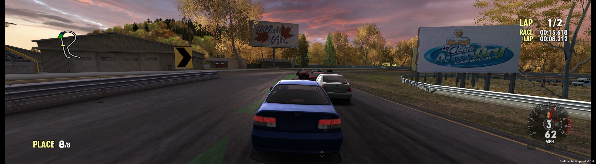

<h1 align="center">Redline Recompiled 0.1</h1>

A PC port of <b>Forza Motorsport</b> (Xbox, 2005), made by static recompilation.

> [!WARNING]
> **Early version.** Performance may be unstable, and expect bugs and crashes.

> [!NOTE]
> **MADE WITH THE HELP OF AI.** This port was made with the help of AI: Anthropic's Claude (in Claude Code) wrote
> and tested much of the code, the tools and these documents, working step by step with the project's author, who
> played and checked the results.

The game's own code, translated from Xbox x86 to 64-bit Windows code, runs natively with a new graphics, sound and
input layer. It plays at up to 144 frames a second, at up to 4x resolution, in widescreen and ultrawide, with
keyboard or any controller.

**Not affiliated with Microsoft or Turn 10 Studios.** Nothing of the game comes with this download: the launcher
builds the port from **your own copy** of the disc, on your PC.

## Screenshots

| With the optional 4x texture pack | With the original Xbox textures |
|---|---|
|  |  |
|  |  |

| The launcher | Its settings |
|---|---|
|  |  |

## What you need

- **Windows 10 or 11, 64-bit**, and a graphics card with DirectX 11.1 (a dedicated card; integrated graphics run it
  at about 25 frames a second). DLSS needs an NVIDIA RTX card; FSR 3 runs on any DirectX 12 card.
- **Your disc image of Forza Motorsport (USA) (Rev 1)**: an `.iso` file, or a folder with the disc's files
  (`Forza.xbe` and `media`). The launcher checks that it is this version; others are not supported.
- **Python 3** from [python.org](https://www.python.org/downloads/) (tick "Add python.exe to PATH" when installing).
  The launcher offers to install the three packages it needs (capstone, Pillow, numpy).
- **Visual Studio C++ build tools**: the free
  [Build Tools for Visual Studio](https://visualstudio.microsoft.com/visual-cpp-build-tools/) with the
  "Desktop development with C++" workload (or Visual Studio with it).
- **About 6 GB of disk space**, and an internet connection during the build: it downloads NVIDIA's DLSS and AMD's FSR
  files from their GitHub pages (each file checked against a known checksum).

## Install and play

1. Download **RedlineRecompiled-0.1.0.zip** from the [Releases](../../releases) page and unzip it anywhere you like
   (a path without unusual characters is safest). (The green Code button's download has no launcher in it:
   `python tools/build.py --launcher` makes one.)
2. Run **RedlineLauncher.exe**.
3. Drop your disc image (or the game folder) on the launcher, or choose it, then press **Build**. The build extracts
   the disc, finds and translates the game's code, and compiles it; it takes a while, and the launcher shows each
   step. If it stops, the launcher shows why.
4. Press **Play**.

The game's files go to `game\`, your saves to `hdd\Partition1\UDATA` (the launcher's **Saves** link), and the game's
log to `build\redline.log` (**Logs**). To update the port later, unzip the new version over this folder and press
**Rebuild**: your saves and settings stay.

## Controls

**Controllers**: Xbox, PlayStation, Switch and most others, plugged in at any time. Buttons go by position (the
bottom face button is A); the right shoulder is the Xbox's Black button, the left one White.

**Keyboard**, two sets that change by themselves between a race and the menus:

| Racing | | Menus | |
|---|---|---|---|
| W / Up | accelerate | Arrows or WASD | move |
| S / Down | brake | Enter or Space | select |
| A D / Left Right | steer | Esc | back |
| Space | handbrake | Tab / Backspace | Start / Back buttons |
| E / Q | gear up / down | X, Y | X, Y buttons |
| C | look back | E / Q | Black / White |
| Z / X | look left / right | Page Up / Down | triggers |
| V | camera | | |
| H | HUD | | |
| Esc | pause | | |

Both sets can be changed in the game: **Recomp Settings > Driving keys / Menu keys**.

## Settings

In the launcher (**Settings**) or in the game's main menu (**Recomp Settings**); they are the same settings.

- **Render scale** 1x-4x: draws each frame larger, for a sharper picture.
- **Upscaling**: FSR 1, NVIDIA DLSS, AMD FSR 3 or plain bilinear.
- **Frame rate** 30 (as on the Xbox), 60, 120 or 144.
- **Texture filter**, **Borderless fullscreen** (Alt+Enter also switches it), **Widescreen**, **Ultrawide** (a wider
  view on a 21:9 or 32:9 monitor, with the HUD at the screen's edges), **Video mode** (480p, 720p, 1080i).
- **Enhanced audio** and **Speakers** (5.1 and 7.1 get the game's surround mix).
- **Quit Game** is at the bottom of the main menu.

## Optional: 4x textures and videos

The settings **Texture pack** and **Upscaled videos** use replacement files you make yourself from your disc (they
come from the game, so they cannot be shared). This is for people comfortable with the command line, and it takes
hours and a fast GPU:

- Textures: `python tools/texextract.py` (every texture on the disc into `build\textures\dump`), then
  `python tools/texpack.py` with [Real-ESRGAN ncnn Vulkan](https://github.com/xinntao/Real-ESRGAN) unpacked to
  `build\realesrgan\` (makes `build\textures\redline4x`).
- Videos: `python tools/vidpack.py`, which also needs ffmpeg and an NVIDIA card for its video encoder (makes
  `build\videos`).

## What does not work

Xbox Live (shut down long ago), System Link and anything else online. Split-screen with two controllers has not been
tried. If the game stops with an error, it says so in a box and names the log: please include `build\redline.log`
when you report it.

## Licence and credits

Redline Recompiled's own code is under the [MIT licence](LICENSE); the files under `third_party/` keep their own.

It uses [SDL3](https://www.libsdl.org/) for controllers (zlib licence), function signatures from
[XbSymbolDatabase](https://github.com/Cxbx-Reloaded/XbSymbolDatabase) (MIT licence code, ODbL data), the kernel export
list from [nxdk](https://github.com/XboxDev/nxdk) (CC0), [Capstone](https://www.capstone-engine.org/) in the build tools
(BSD licence), AMD FidelityFX Super Resolution (MIT licence; the signed FSR 3 libraries under AMD's licence), and
NVIDIA DLSS (NVIDIA RTX SDK licence; DLSS is NVIDIA's). Forza Motorsport is Microsoft's; this project contains none
of it.
