
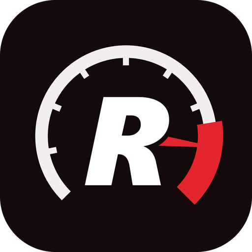

<h1 align="center">Redline Recompiled 0.3.0 alpha</h1>

A PC port of <b>Forza Motorsport</b> (Xbox, 2005), made by static recompilation.

<table align="center">
<tr><td>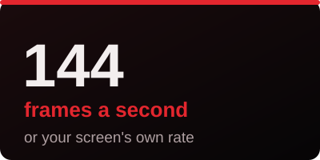</td><td>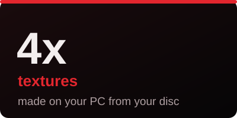</td><td>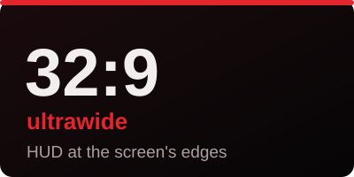</td></tr>
<tr><td>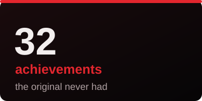</td><td>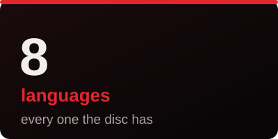</td><td>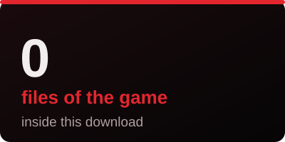</td></tr>
</table>

> [!WARNING]
> **Alpha, version 0.3.0.** It plays from start to finish, but performance may be unstable, and expect bugs and crashes.

> [!NOTE]
> **MADE WITH THE HELP OF AI.** This port was made with the help of AI: Anthropic's Claude (in Claude Code) wrote
> and tested much of the code, the tools and these documents, working step by step with the project's author, who
> played and checked the results.

<!-- contents -->

          

<!-- /contents -->

<a href="https://github.com/DivxPlays/redline-recompiled/releases/download/v0.3.0-alpha/trailer.mp4">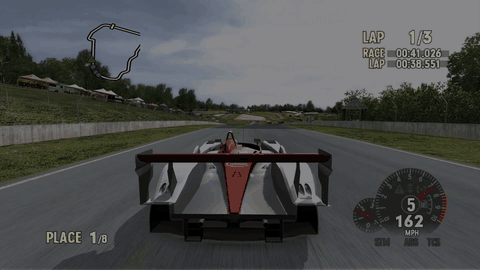</a> 
<a href="https://github.com/DivxPlays/redline-recompiled/releases/download/v0.3.0-alpha/trailer.mp4"><b>Watch the trailer</b></a> (40 seconds)

The game's own code, translated from Xbox x86 to 64-bit Windows code, runs natively with a new graphics, sound and
input layer. It plays at your screen's refresh rate (up to 144 frames a second), at up to 4x resolution, in widescreen
and ultrawide, with keyboard or any controller, and with achievements the original never had.

**Not affiliated with Microsoft or Turn 10 Studios.** Nothing of the game comes with this download: the launcher
builds the port from **your own copy** of the disc, on your PC.

## Screenshots

| With the 4x textures | With the original Xbox textures |
|---|---|
| 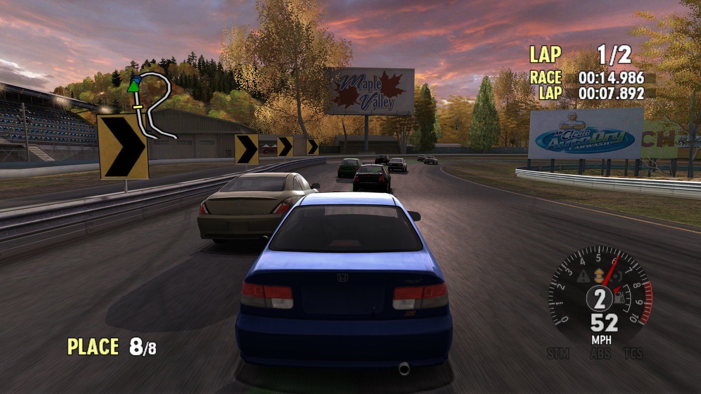 | 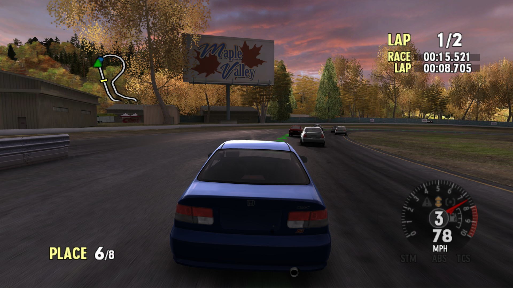 |
| 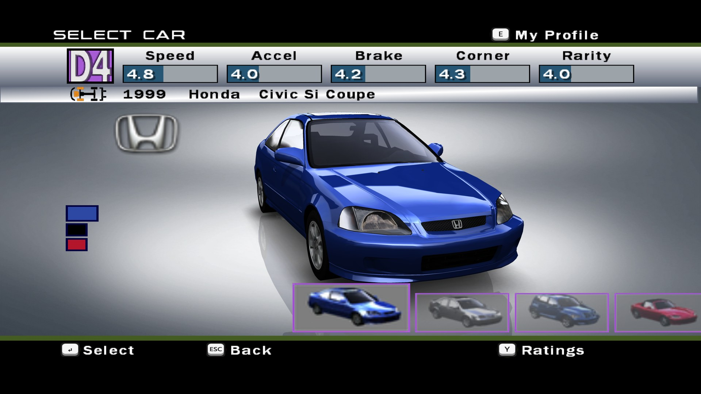 | 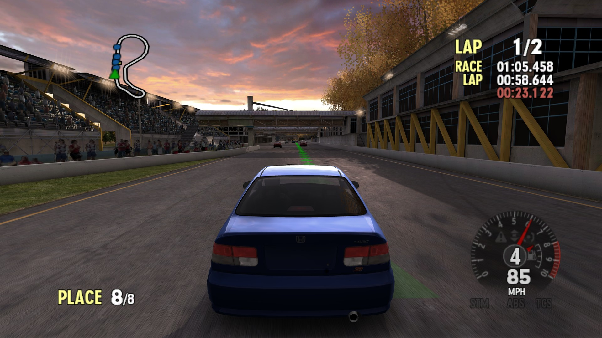 |

| The launcher | Its settings |
|---|---|
| 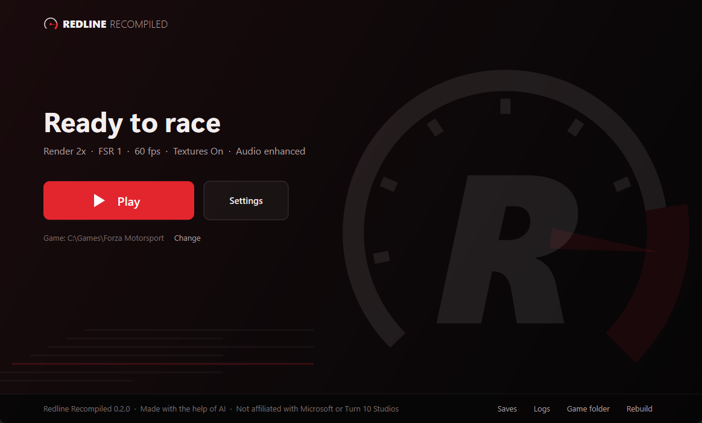 | 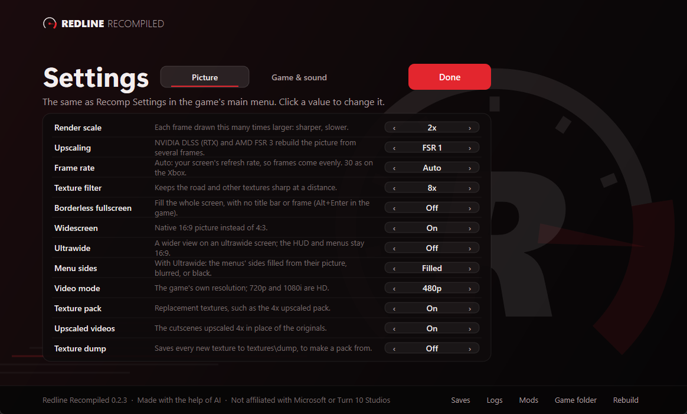 |

## What you need

- **Windows 10 or 11, 64-bit**, and a graphics card with DirectX 11.1 (a dedicated card; integrated graphics run it
  at about 25 frames a second). DLSS needs an NVIDIA RTX card; FSR 3 runs on any DirectX 12 card.
- **Your disc image of Forza Motorsport (USA) (Rev 1)**: an `.iso` file (an XISO or a full-disc dump), or a folder
  with the disc's files (`Forza.xbe` and `media`). The launcher checks that it is this version; others are not
  supported.
- **Nothing to install.** The first build downloads its own tools (Python, the Capstone disassembler and the zig C
  compiler, about 95 MB, from their makers' sites) and NVIDIA's DLSS and AMD's FSR files, each checked against a known
  checksum. So it needs an internet connection the first time.
- **About 7 GB of disk space**, and 12 GB more for the optional 4x textures.

## Install and play

1. Download **RedlineRecompiled-0.3.0.zip** from the [Releases](../../releases) page and unzip it to a folder whose
   path is short, at most 120 characters (for example `C:\Games\RedlineRecompiled`).
2. Run **RedlineLauncher.exe**.
3. Drop your disc image (or the game folder) on the launcher, or choose it, then press **Build**. The first build
   takes about 5 to 10 minutes, and the launcher shows each step. If it stops, the launcher shows why.
4. Press **Play**.

Your saves are in `hdd\Partition1\UDATA` (the launcher's **Saves** link) and the game's log in `build\redline.log`
(**Logs**). The launcher says when a newer version is out: unzip it over this folder and press **Update**. The launcher
builds the game again, as each version changes it, and your saves and settings stay.

## Controls

**Controllers**: Xbox, PlayStation, Switch and most others, plugged in at any time. Buttons go by position (the
bottom face button is A); RB and LB are the Xbox's Black and White buttons, or the gears with **Shift on Shoulders**.
A controller's racing buttons can be changed in **Recomp Settings > Controller Buttons**: choose an action, press the
button. They hold in every layout of the game's own Controller Options.

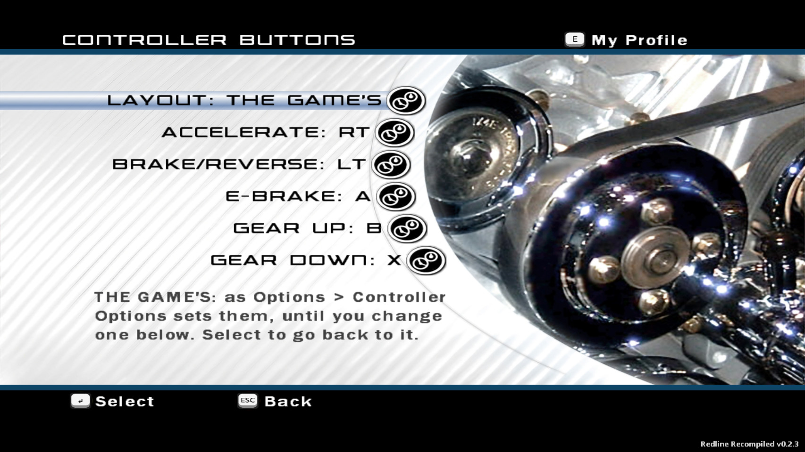

**Keyboard**, two sets that change by themselves between a race and the menus:

| Racing | | Menus | |
|---|---|---|---|
| W / Up | accelerate | Arrows or WASD | move |
| S / Down | brake | Enter or Space | select |
| A D / Left Right | steer | Esc | back |
| Space | handbrake | Tab / Backspace | Start / Back buttons |
| E / Q | gear up / down | X, Y | X, Y buttons |
| C | look back | E / Q | Black / White |
| Z / X | look left / right | Page Up / Down | triggers |
| V | camera | | |
| H | HUD | | |
| Esc | pause | | |

The racing keys follow the layout chosen in the game's Options > Controller Options. Both sets can be changed in
**Recomp Settings > Driving keys / Menu keys**. The launcher works with a controller too: the d-pad moves, A chooses,
B goes back.

## Settings

In the launcher (**Settings**, in two tabs: Picture, and Game & sound; LB / RB or Tab) or in the game's main menu
(**Recomp Settings**); they are the same settings.

- **Language**: the game's eight (English, German, French, Spanish, Italian, Japanese, Korean, Chinese).
- **Render scale** 1x-4x, **Upscaling** (FSR 1, NVIDIA DLSS, AMD FSR 3 or bilinear), **Texture filter**.
- **Frame rate**: **Auto** by default, your screen's refresh rate, so frames come evenly; or 60, 120, 144 or 30.
- **Borderless fullscreen** (Alt+Enter too), **Widescreen**, **Video mode** (480p, 720p, 1080i).
- **Ultrawide**: a wider view on a 21:9 or 32:9 screen, the HUD at its edges, and **Menu sides** filled from each
  menu's own picture (or black).
- **Shift on Shoulders**, **Rumble strength**, **Button prompts**, **Enhanced audio**, **Speakers** (5.1 and 7.1) and
  **Achievement sound**.
- **Quit Game** is at the bottom of the main menu.

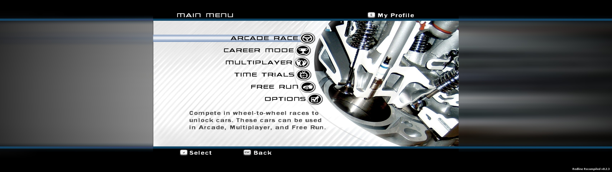

## Achievements

32 achievements that the original game never had: racing, career, garage, modes and tracks. Each one pops up the
way the Xbox 360 showed them, in Redline's colours, with the opening of the game's own fanfare. **Achievements** on
the main menu lists them all. See [docs/achievements.md](docs/achievements.md).

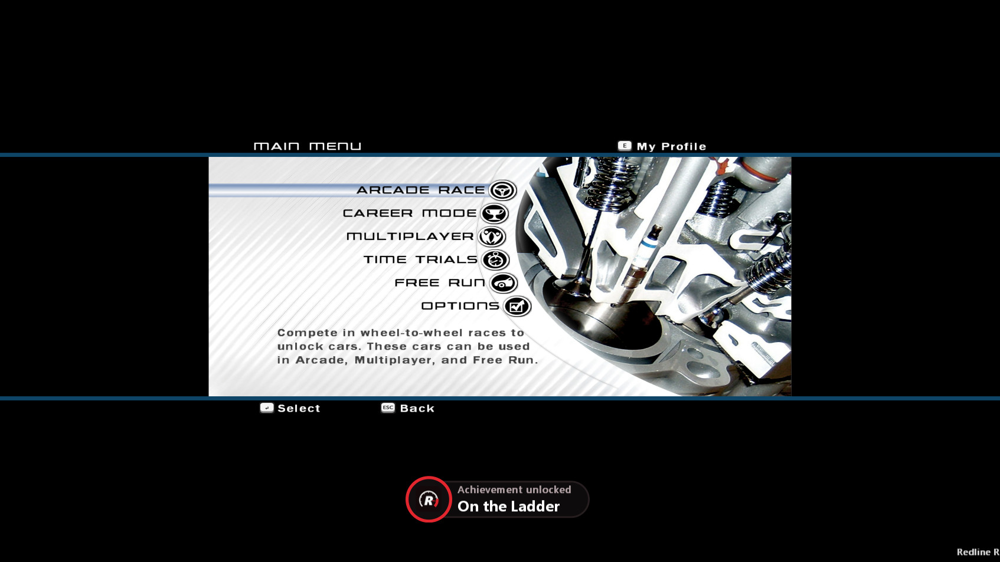

## Mods

Put each mod in its own folder in `mods` (the launcher's **Mods** link opens it), with its files at the same paths as
in the game folder: to change a file, copy it from `game` to `mods\<your mod>` at the same path and change the copy.
Turn each one on or off in **Recomp Settings > Mods**; it takes effect at the next start, and when two mods have the
same file, the first by name wins. Whole files only: the menus' pictures are inside the archives in `media\cabs`.
Share only what you made, never the game's own files.

## Optional: 4x textures and videos

**Make 4x textures** on the launcher's Ready page makes every texture on your disc four times as detailed with
Real-ESRGAN on your graphics card. It takes about an hour and a half on a fast card (longer on others), needs about
12 GB and a graphics card with Vulkan, and downloads its tools the first time (about 67 MB). Cancel stops it; the
next time it picks up where it stopped. **Texture pack** in Settings turns them on and off.

The upscaled videos are still made on the command line: `python tools/vidpack.py`, which needs ffmpeg and an NVIDIA
card for its video encoder.

## FAQ

<b>Does this download include the game?</b>

No. Nothing of the game comes with it: the launcher builds the PC version on your PC from your own copy of the disc.

<b>Can someone send me a built copy?</b>

No. The built game is made from the disc's own code, so it cannot be shared. Build it from your copy; if the build
stops, open an issue with the launcher's log.

<b>Which version of the game does it need?</b>

Forza Motorsport (USA) (Rev 1), as an `.iso` (an XISO or a full-disc dump) or a folder with `Forza.xbe` and `media`.
The launcher checks your copy as soon as you choose it, and says what it is if it is another one.

<b>Why does the first Build download things?</b>

So that nothing needs installing: Python, Capstone and the zig compiler (about 95 MB) and the DLSS and FSR files come
from their makers, each checked against a fixed checksum, into the port's `build\tools` folder.

<b>The build stopped. What now?</b>

The launcher says why, and **Show details** shows its log. The usual causes: a folder path longer than 120 characters
(move the port to something like `C:\Games\RedlineRecompiled`), a download your PC blocks (download the file it names
in your browser and leave it in Downloads), or another release of the game. Otherwise, open an issue with the log.

<b>It stutters. What can I try?</b>

Keep **Frame rate** on Auto, lower **Render scale**, or try DLSS (NVIDIA RTX) or FSR 3. PCs with two CPU cores can
still hitch when the camera view changes.

<b>Does it run on Steam Deck or Linux?</b>

Not yet: Windows 10 and 11 only for now. Running it under Proton has not been tested.

<b>Does my steering wheel work?</b>

Not yet. Controllers Windows sees as gamepads work; wheels are on the roadmap ([#27](../../issues/27)).

<b>Will my saves survive an update?</b>

Yes. Unzip the new version over the old folder and press **Update**; your saves and settings stay.

## What does not work

Xbox Live (shut down long ago), System Link and anything else online. If the game stops with an error, it says so in
a box, names the log and offers to report it: a new GitHub issue opens in your browser, filled in with the version
and the end of the log (your user name and folders taken out). Nothing is sent unless you submit it.

## Licence and credits

Redline Recompiled's own code is under the [MIT licence](LICENSE); the files under `third_party/` keep their own.

It uses [SDL3](https://www.libsdl.org/) for controllers (zlib licence), function signatures from
[XbSymbolDatabase](https://github.com/Cxbx-Reloaded/XbSymbolDatabase) (MIT licence code, ODbL data), the kernel export
list from [nxdk](https://github.com/XboxDev/nxdk) (CC0), AMD FidelityFX Super Resolution (MIT licence; the signed
FSR 3 libraries under AMD's licence), and NVIDIA DLSS (NVIDIA RTX SDK licence; DLSS is NVIDIA's). The build downloads
and runs [Python](https://www.python.org/) (PSF licence), [Capstone](https://www.capstone-engine.org/) (BSD licence)
and [zig](https://ziglang.org/) (MIT licence); Make 4x textures downloads Real-ESRGAN ncnn Vulkan (BSD 3-Clause),
numpy (BSD 3-Clause) and Pillow (MIT-CMU). Forza Motorsport is Microsoft's; this project contains none of it.